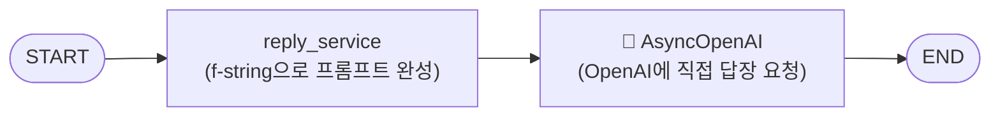
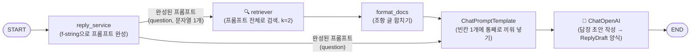
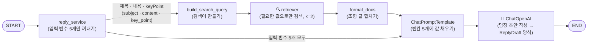
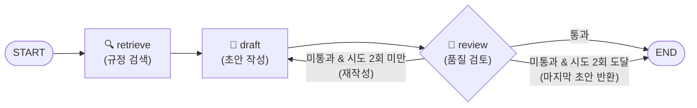
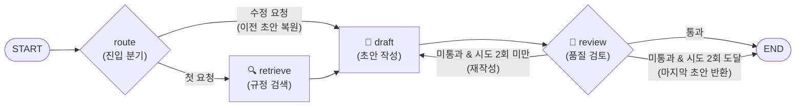

# 답장 초안 API 리팩토링 흐름

`POST /api/emails/{email_id}/reply`가 OpenAI SDK 직접 호출에서 LangChain 체인, LangGraph 그래프로 바뀌어 온 과정을 시간 순서로 정리한다.

- 🧠 LLM을 호출하는 단계
- 🔍 규정 검색 단계
- 마름모: 결과에 따라 갈라지는 단계

---

## ① LangChain 적용 전: OpenAI SDK 직접 호출

- 서비스가 프롬프트 문자열을 직접 만들고, `OpenAiLlmClient`가 OpenAI SDK를 바로 호출한다.
- 응답은 문자열 하나다.

---

## ② 과제 제출본 = LCEL 체인 + RAG 

이전 대비 추가된 것
- `ChatOpenAI`와 LCEL 파이프로 교체하고, lifespan에서 한 번만 생성한다. (1단계)
- 구조화 출력 `ReplyDraft`로 본문과 근거 조항, 확인 필요 항목, 발신자 직급을 함께 받는다. (2단계)
- Chroma 규정집 검색 결과를 `[참고 규정]`으로 넣는다. (6단계)

---

## 부록: 1단계 보완 (f-string → 템플릿 빈칸)

흐름의 모양은 같고, **누가 조립하는지**와 **검색에 무엇을 쓰는지**만 바뀌었다.

| | 전 | 후 |
|---|---|---|
| reply_service | f-string으로 프롬프트 완성 | 입력 변수 5개만 꺼내서 전달 |
| 검색어 | 프롬프트 전체 (라벨, 관계, 보낸 사람 포함) | 제목, 내용, keyPoint만 (`build_search_query`) |
| 템플릿 | `{question}` 빈칸 1개 | 빈칸 5개, 템플릿이 직접 조립 |

입력 변수: `sender_name`, `sender_relationship`, `subject`, `content`, `key_point` (출처: 받은 메일 `email`과 요청 본문 `request`)

---

## ③ 3단계: 초안 → 검토 → 재작성 그래프 (설계)

> 구현 후 `graph.get_graph().draw_mermaid()` 결과로 교체한다.

이전 대비 추가된 것
- 한 방향 체인이 그래프가 되고, `review`가 `{passed, reason}`으로 초안을 판정한다.
- 미통과 사유(`reason`)를 `feedback`으로 넘겨 다시 쓴다. 시도 횟수(`attempts`) 상한으로 무한 루프를 막는다.

---

## ④ 최종: 수정 요청과 스트리밍 (4·5단계, 설계)

> 구현 후 `draw_mermaid()` 결과로 교체한다.

이전 대비 추가된 것
- `InMemorySaver` 체크포인터와 `thread_id = email_id`로 직전 초안을 기억한다. `POST /reply/revise`에 수정 지시 한 줄만 보낸다. (5단계)
- `POST /reply/stream`에서 `astream(stream_mode="messages")`로 draft 노드의 토큰만 SSE로 보낸다. (4단계)
- `route`는 노드가 아니라 START에서 나가는 조건부 엣지로 만든다.
